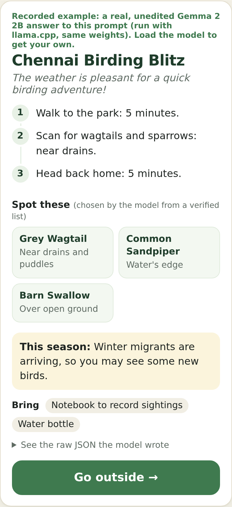
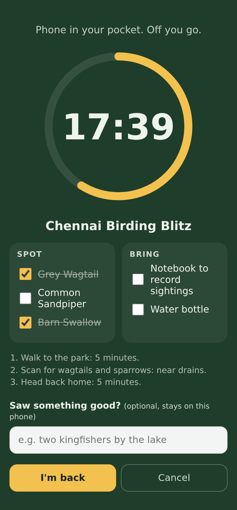
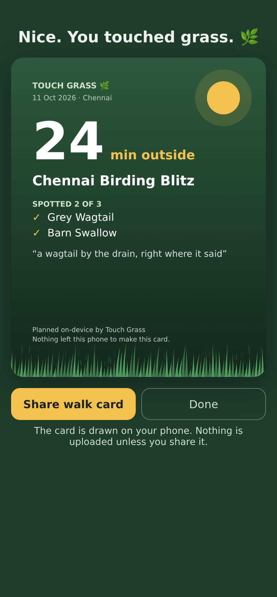

# Touch Grass 🌿

**Plan in 30 seconds. Spend the rest outside.**

Touch Grass is a one-screen outdoor planner. You tell it where you are, how long you have, what you feel like (birding, walking, gardening, beach, cycling) and what the weather is doing. **Gemma 2 2B, running inside your browser**, writes a short structured plan: a title, three timed steps, three or four things to spot, a seasonal tip and what to bring. Then you press **Go outside**, the screen turns into a calm timer with tick-off checklists, and when you're back you get a **walk card** image, drawn on your phone, that you can share or keep.

**Live demo:** https://ess-cor.github.io/touch-grass-chennai/
(No WebGPU? Tap “See a real Gemma 2 plan”, or open [`?sample`](https://ess-cor.github.io/touch-grass-chennai/?sample).)

Built for the DEV [Hacktoberfest Open-Source AI Challenge, Week 1: Touch Grass](https://dev.to/challenges/hacktoberfest-week1-2026-10-05).

| Plan (real Gemma 2 output) | Outside mode | Walk card |
|---|---|---|
|  |  |  |

## What makes it work

- **Gemma 2 on your device.** [WebLLM](https://github.com/mlc-ai/web-llm) (Apache-2.0) runs `gemma-2-2b-it-q4f16_1-MLC` (or the `q4f32` build on GPUs without `shader-f16`) through WebGPU. A **lite** option, Qwen2.5 0.5B Instruct, is there for phones with less memory.
- **Structured output that can't invent birds.** The model answers in JSON that is constrained by a JSON Schema during decoding (XGrammar inside WebLLM). The `spot` names are an `enum` built per request from a hand-written list of birds that are actually around Chennai this season, plus things you can find anywhere. So the model *chooses and explains*; it cannot make up a species.
- **Code does the maths and the safety.** Small models are bad at arithmetic, so the app splits your time (out / main / back) and hands the model the numbers. Safety rules (shade in the heat, stay at the doorstep in a storm, never swim at these beaches) are in the prompt *and* enforced in code after the model answers.
- **Three layers of fallback.** Schema-constrained JSON → plain JSON with validation → a rule-based planner built on the same seasonal data. You always get a plan, and the label tells you which one you got.
- **Nothing leaves the device.** No server, no API key, no analytics. Your city, your notes, your log and your walk card stay in the browser. Live weather from [Open-Meteo](https://open-meteo.com/) (open data, no key) is fetched only if you tap the button.
- **Works offline after the first load.** A service worker caches the app and the WebLLM library, and WebLLM caches the model weights. Next time it starts from cache with no signal.

## Files

| File | What it does |
|---|---|
| `index.html` | Plan screen, outside screen, walk-card screen |
| `app.js` | UI, WebGPU check, model loading, constrained generation, timer, log |
| `planner.js` | Chennai seasonal data, field notes, prompt + JSON Schema builder, validator, guardrails, rule-based planner |
| `card.js` | Draws the walk card on a `<canvas>` and shares it with the Web Share API |
| `weather.js` | Optional live weather from Open-Meteo |
| `samples.js` | One real, unedited Gemma 2 2B answer to the app's prompt (recorded with llama.cpp) for browsers without WebGPU |
| `sw.js` | Offline cache |
| `tests/planner.test.mjs` | `node --test tests/planner.test.mjs` |

No build step. Serve the folder with any static server (for example `python3 -m http.server`) and open it in a browser with WebGPU (recent Chrome or Edge on desktop or Android).

## Limits, honestly

- The first model download is large: about 1.4 GB for Gemma 2 2B, about 270 MB for the lite model. Do it on Wi-Fi.
- WebGPU support varies. Where it's missing you get the built-in planner, plus the recorded example.
- The `spot` list is constrained, but the free-text steps are not: a 2B model can still mention a bird that isn't on the list (the recorded sample mentions “sparrows”). The checklist and the walk card only ever use the verified names.
- The seasonal notes are written for Chennai and are general guidance, not a field guide. Check rain alerts and opening times before you go.
- The screenshots come from a headless test run, not from a real walk.

## Licence

MIT © 2026 Mohamed Adib. WebLLM is Apache-2.0. Gemma 2 is released under the Gemma Terms of Use; Qwen2.5 0.5B under Apache-2.0. Weather data © Open-Meteo (CC BY 4.0).
